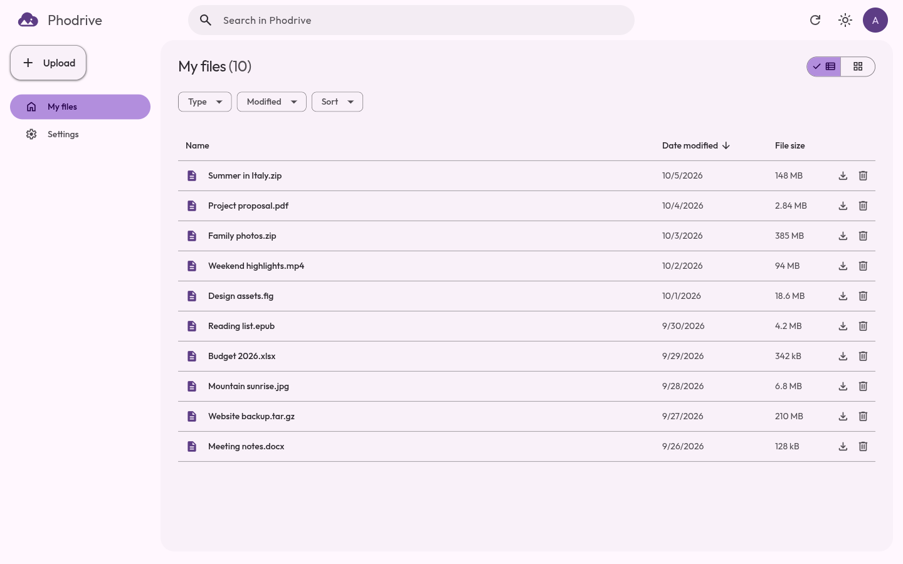
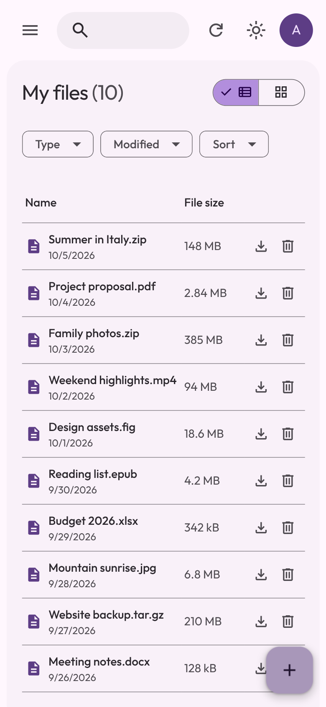
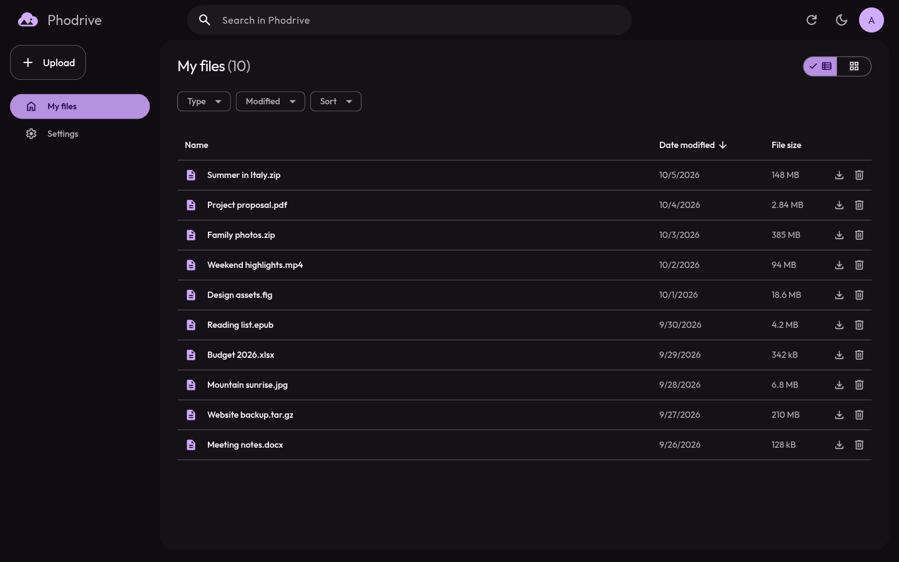
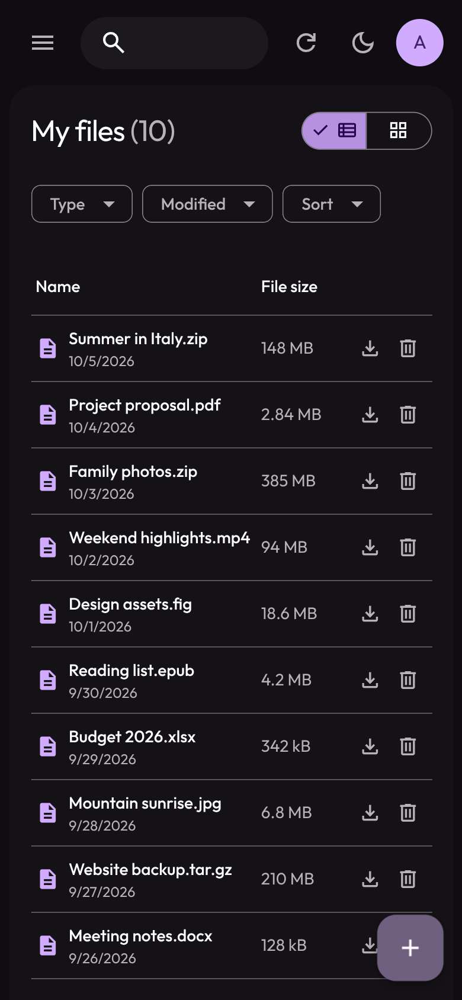
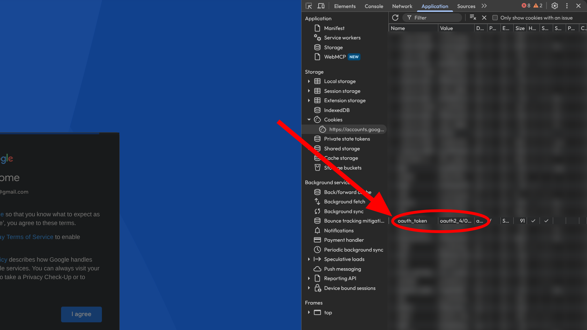

<p align="center">
    
    <h1 align="center">Phodrive</h1>
    <p align="center"><i>Files worth a thousand pixels.</i></p>
</p>

Use Google Photos as a cloud storage provider by spoofing a Pixel XL device to get unlimited storage.

> [!CAUTION]
> Using this project may violate Google's terms or policies and could result in your Google account being restricted or banned.

<table>
    <tr>
        <td></td>
        <td></td>
    </tr>
    <tr>
        <td></td>
        <td></td>
    </tr>
</table>

## Development

Use Node.js 24.21 or newer, or Bun, and Docker for PostgreSQL.

```sh
bun install
cp .env.example .env    # then set BETTER_AUTH_SECRET, for example with: openssl rand -base64 32
docker compose up -d db
bun --bun run dev
```

Open `http://127.0.0.1:5173`. With Node.js, use `npm install` and `npm run dev` instead. The app applies database migrations when it starts. After changing `app/src/lib/server/db/schema.ts`, run `bun run --cwd app db:generate` to add a migration.

The repository uses [Bun workspaces](https://bun.sh/docs/pm/workspaces), also supported by npm. `app/` contains the SvelteKit web app and its Hono API. `core/` is the standalone `@madkarmaa/phodrive-core` library for the file format, Google Photos protocol, and transfers. `cli/` is the `phodrive` command line. Root commands build core before running the app. Run the command line from source with `bun run cli <command>`, for example `bun run cli file list`. See [core usage](./core/README.md) for using the library elsewhere.

Keep environment files at the repository root, for example `.env`.

### Verification

Tests use [Vitest](https://vitest.dev/).

```sh
bun run check
bun run test
bun run build
```

## Deployment

> [!WARNING]
> If other machines can reach the server, serve it over HTTPS and set `PHODRIVE_DISABLE_SIGNUP=true` once your users have signed up.

### From source

Install dependencies with `bun install`, then set up `.env` and PostgreSQL as in [Development](#development). The start commands read `.env` from the repository root.

To build and run with Node.js:

```sh
bun run build
bun run start
```

To build and serve using Bun:

```sh
bun --bun run build
bun run start:bun
```

Open `http://127.0.0.1:3000` for the production build.

### Docker

[`compose.yaml`](./compose.yaml) runs the app with PostgreSQL. Set `BETTER_AUTH_SECRET` in `.env` next to it, then:

```sh
docker compose pull
docker compose up -d
```

Open `http://localhost:3000` or `http://127.0.0.1:3000`. The server derives its origin from the request host and port, including a different published port. To override it, set `ORIGIN` and `BETTER_AUTH_URL` to the exact origin used in your browser, for example `http://localhost:3000`.

### Server settings

| Environment variable      | Required | Description                                                                                                                                 |
| ------------------------- | -------- | ------------------------------------------------------------------------------------------------------------------------------------------- |
| `DATABASE_URL`            | Yes      | PostgreSQL connection URL                                                                                                                   |
| `BETTER_AUTH_SECRET`      | Yes      | At least 32 characters. Signs sessions and encrypts stored Google tokens; changing it signs everyone out and makes them replace their token |
| `BETTER_AUTH_URL`         | No       | Public origin of the app; derived from each request when unset                                                                              |
| `PHODRIVE_DISABLE_SIGNUP` | No       | `true` stops new signups; defaults to `false`                                                                                               |

### Deployment defaults

Settings use your saved choice first, then the deployment default, then the built-in default. Phodrive saves a browser preference only when you choose a value. Users without a saved choice receive updated deployment defaults.

| Environment variable                        | Built-in default | Allowed values                                           |
| ------------------------------------------- | ---------------- | -------------------------------------------------------- |
| `PHODRIVE_DEFAULT_REFRESH_INTERVAL_SECONDS` | `60`             | Whole seconds from `0` to `86400`; `0` disables refresh  |
| `PHODRIVE_DEFAULT_CONCURRENT_WORKERS`       | `8`              | Whole numbers from `1` to `32`                           |
| `PHODRIVE_DEFAULT_THEME`                    | `auto`           | `auto`, `light`, `dark`                                  |
| `PHODRIVE_DEFAULT_SORT`                     | `modified-desc`  | `modified-desc`, `modified-asc`, `name-asc`, `name-desc` |

Set these variables in the server environment before starting the app. Missing or invalid values use the built-in defaults. The server publishes the validated settings defaults. For example:

```sh
bunx cross-env PHODRIVE_DEFAULT_REFRESH_INTERVAL_SECONDS=120 PHODRIVE_DEFAULT_CONCURRENT_WORKERS=4 bun run start
```

For Docker, pass the same variables with `-e`, for example `-e PHODRIVE_DEFAULT_CONCURRENT_WORKERS=4`.

## Create an account

Each Phodrive account belongs to one Google account.

1. Open the app at the address shown above for your setup and choose **Create account**.
2. Sign in at [Google Embedded Setup](https://accounts.google.com/EmbeddedSetup).
3. In developer tools, open Application, then Cookies, then `https://accounts.google.com`. Copy the cookie value starting with `oauth2_4/`.
4. Enter your Google account email, a password, and the token.



Afterwards, sign in with the email and password. To use another Google account, sign out and sign in with, or create, its Phodrive account. If Google stops accepting the token, replace it in Settings.

> [!NOTE]
> The server exchanges the token, stores it encrypted in the database, and makes every Google Photos request itself. The browser never receives the token.

## Command line

The `phodrive` command does everything the web app does without running the server. Each [release](https://github.com/madkarmaa/phodrive/releases/latest) includes executables that don't need Node.js. On Linux or macOS, download yours and make it executable:

```sh
curl -fLo phodrive https://github.com/madkarmaa/phodrive/releases/latest/download/phodrive-linux-x64
chmod +x phodrive
```

Replace `linux-x64` with `linux-arm64`, `darwin-arm64`, or `darwin-x64` for other systems, and add `-musl` on Alpine Linux. On Windows, download `phodrive-windows-x64.exe` or `phodrive-windows-arm64.exe` from the release page. On macOS, download with `curl` instead of a browser, because Gatekeeper blocks apps that a browser downloads unless Apple notarized them. Move the executable to a folder on your `PATH`. `phodrive update` replaces it with the latest release.

The npm package is on GitHub Packages, and installing from there needs a GitHub [personal access token (classic)](https://github.com/settings/tokens) with the `read:packages` scope, even for public packages. Add the registry and your token to `~/.npmrc`:

```ini
@madkarmaa:registry=https://npm.pkg.github.com
//npm.pkg.github.com/:_authToken=YOUR_GITHUB_TOKEN
```

Then install it with `npm install --global @madkarmaa/phodrive-cli`, or run it once with `npx @madkarmaa/phodrive-cli`. To build an executable yourself, run `bun run compile` in a clone of this repository. It writes `cli/build/phodrive`, or `cli/build/phodrive.exe` on Windows.

```sh
phodrive account add you@gmail.com   # asks for the oauth2_4/ token from the steps above
phodrive file list                   # add a search term, --type pdf, --days 30, or --sort name-asc
phodrive file upload ./photos        # files and whole folders
phodrive file download report.pdf    # by name or by the ID that file list shows
phodrive file delete report.pdf
phodrive setting set workers 4
```

`phodrive help` lists every command. `phodrive help file upload`, `phodrive file upload --help`, and `phodrive file upload -h` all show the options of one command.

`phodrive` saves accounts and settings in `config.json` in your user configuration folder. On macOS and Linux, only your user can read that file. Set `PHODRIVE_CONFIG` to use another file.

## Attribution

Copyright © 2026 MadKarma (madkarmaa). Phodrive is licensed under the MIT License; see [LICENSE](./LICENSE).

The Google Photos protocol code is based on [xob0t/gotohp](https://github.com/xob0t/gotohp) (MIT).

The Photos library request mask is based on [xob0t/gpmc](https://github.com/xob0t/gpmc) (MIT).

The OAuth2-to-AAS exchange is adapted from [xhyrom/sniff](https://github.com/xhyrom/sniff) (Apache-2.0).

The OAuth2 exchange's DroidGuard compatibility field follows [simon-weber/gpsoauth](https://github.com/simon-weber/gpsoauth) (MIT).
